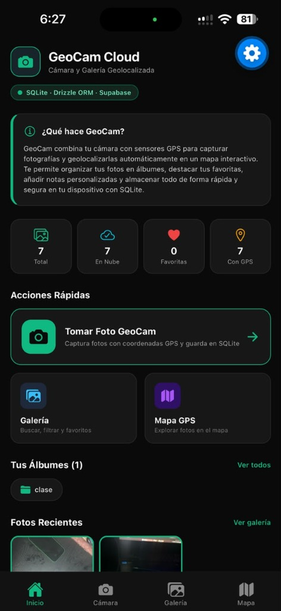
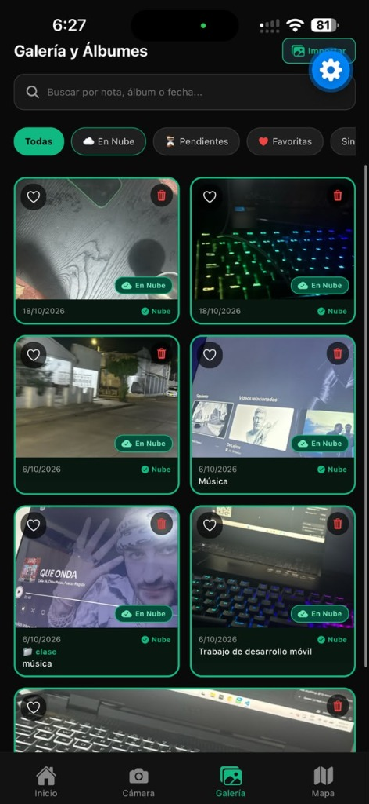
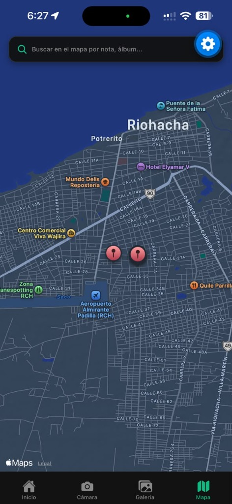

# GeoCam-2.0

Aplicación móvil de **Cámara, Galería Geolocalizada y Almacenamiento en la Nube**, desarrollada con **React Native**, **Expo SDK 52/53**, **TypeScript**, **SQLite**, **Drizzle ORM** y **Supabase** (Storage & Database).

**Desarrollador:** Camilo Gómez  
**Versión:** 2.0.0 (Semana 8 — Cloud Sync & Offline-First)  
**Repositorio GitHub:** [https://github.com/camilogo22/GeoCam-2.0](https://github.com/camilogo22/GeoCam-2.0)

---

## Capturas de Pantalla en Dispositivo Físico (iOS / iPhone)

| Pantalla de Inicio (Cloud Dashboard) | Galería Sincronizada en la Nube | Mapa GPS Interactivo (Riohacha) |
| :---: | :---: | :---: |
|  |  |  |
| *Métricas reactivas: 7/7 fotos en la nube, conteo GPS, álbumes y accesos rápidos.* | *Bordes esmeralda, badges En Nube, filtros dinámicos e importador.* | *Pines geolocalizados de capturas fotográficas en Riohacha, Colombia.* |

---

## Características Principales de GeoCam 2.0

### 1. Cámara Geolocalizada & Sensores Nativos
* Captura de fotos en tiempo real con `expo-camera`.
* Detección automática de coordenadas de alta precisión (latitud, longitud y exactitud) mediante `expo-location`.
* **Degradación elegante**: Si el usuario no otorga permisos de GPS, las fotos se guardan localmente sin bloquear la experiencia de la cámara.
* **Acelerómetro (`useShake`)**: Agitar el dispositivo permite vaciar la galería con confirmación de seguridad.

### 2. Base de Datos Local Offline-First (SQLite + Drizzle ORM)
* Almacenamiento local ultrarrápido con `expo-sqlite` y `drizzle-orm/expo-sqlite`.
* Cumplimiento estricto de integridad referencial con `PRAGMA foreign_keys = ON;`.
* Consultas reactivas en tiempo real mediante `useLiveQuery` (la UI se actualiza instantáneamente ante cualquier cambio en la base de datos).
* **Migraciones versionadas con Drizzle Kit**:
  * `0000_sturdy_omega_sentinel.sql`: Tablas `albums` y `photos`.
  * `0001_flippant_retro_girl.sql`: Adición de `note` (texto) y `favorite` (booleano).
  * `0002_great_scarecrow.sql`: Campos de sincronización en la nube (`clientId`, `remotePath`, `syncedAt`, `updatedAt`, `ownerId`).

### 3. Backend as a Service con Supabase (Semana 8)
* **Almacenamiento en Storage**: Bucket público `geocam` para subida, descarga y persistencia de imágenes en la nube.
* **Base de datos remota PostgreSQL**: Tabla `photos` con metadatos completos sincronizados.
* **Seguridad RLS (Row Level Security)**: Políticas permisivas configuradas para operaciones anónimas y autenticadas.
* **Distinción visual de sincronización**:
  * Las fotos subidas a la nube cuentan con un **borde verde esmeralda brillante (`#10b981`)** y un badge prominente **`En Nube`**.
  * Filtros dedicados en galería para alternar entre: `Todas`, `En Nube`, `Pendientes`, `Favoritas` y álbumes.
* **Borrado coherente**: Al eliminar una foto sincronizada, se borra física y lógicamente de SQLite, del sistema de archivos local y del bucket/tabla en Supabase.
* **Importador desde Galería**: Permite seleccionar fotos existentes del carrete del teléfono (con soporte nativo para URIs `content://`, `ph://` y rutas de caché).

### 4. Mapa Interactivo
* Visualización de fotos en el mapa nativo con `react-native-maps`.
* Marcadores personalizados con callouts que permiten abrir el detalle de cada foto directamente desde el mapa.

---

## Arquitectura de la Base de Datos

```text
+-----------------------------------+             +-----------------------------------+
|              albums               |             |              photos               |
+-----------------------------------+             +-----------------------------------+
| id: integer (PK, AutoIncrement)   |<------------| id: text (PK)                     |
| name: text (Unique, Not Null)     |  1       0..*| uri: text (Not Null)             |
| created_at: integer (Not Null)    |             | latitude: real                    |
+-----------------------------------+             | longitude: real                   |
                                                  | accuracy: real                    |
                                                  | source: text (camera/gallery)     |
                                                  | created_at: integer (Not Null)    |
                                                  | album_id: integer (FK, Set Null)  |
                                                  | note: text (Nullable)             |
                                                  | favorite: integer (Boolean, 0)    |
                                                  | client_id: text (UUID, Nullable)  |
                                                  | remote_path: text (Nullable)      |
                                                  | synced_at: integer (Nullable)     |
                                                  | updated_at: integer (Nullable)    |
                                                  | owner_id: text (Nullable)         |
                                                  +-----------------------------------+
```

---

## Estructura del Código

```text
semana-7/
├── app/
│   ├── (tabs)/
│   │   ├── _layout.tsx           # Navegación por pestañas: Inicio, GeoCam, Galería y Mapa
│   │   ├── inicio.tsx            # Dashboard con métricas cloud y sincronización masiva
│   │   ├── geocam.tsx            # Captura de cámara, GPS en vivo e importación
│   │   ├── galeria.tsx           # Galería con filtros (Nube, Pendientes, Álbumes, Favoritas)
│   │   ├── mapa.tsx              # Mapa nativo con marcadores geolocalizados
│   │   └── mapa.web.tsx          # Mapa adaptado para navegador Web
│   ├── photo/
│   │   └── [id].tsx              # Detalle de foto: nota, álbum, favoritos y botón Subir a la Nube
│   ├── _layout.tsx               # Root Layout con migrador useMigrations()
│   └── index.tsx                 # Redirección automática a /(tabs)/inicio
├── db/
│   ├── client.ts                 # Instancia de Drizzle ORM y SQLite
│   ├── schema.ts                 # Esquemas relacionales con llaves foráneas y tipos
│   └── repositories/             # Capa de acceso a datos Drizzle
├── drizzle/                      # Migraciones versionadas en archivos SQL
├── lib/
│   ├── secureStorage.ts          # Almacenamiento seguro nativo con Expo SecureStore
│   └── supabase.ts               # Cliente Supabase singleton con auto-refresh
├── services/
│   ├── cloudPhotos.ts            # Sincronización con Supabase Storage y base de datos remota
│   ├── photoFiles.ts             # Persistencia permanente en FileSystem y borrado físico
│   └── photosRepository.ts       # Orquestador entre SQLite, FileSystem y Cloud
├── hooks/                        # Custom hooks: usePhotos, useAlbums, useCamera, useGeoLocation, useShake
├── screenshots/                  # Capturas reales de la aplicación en iPhone
│   ├── inicio.jpg
│   ├── galeria.jpg
│   └── mapa.jpg
├── supabase/
│   └── schema.sql                # Script SQL idempotente para tablas, RLS y bucket en Supabase
├── drizzle.config.ts             # Configuración de Drizzle Kit
└── README.md                     # Documentación oficial del proyecto
```

---

## Instalación y Puesta en Marcha

### Prerrequisitos
* **Node.js**: v18 o superior
* **Expo Go** o simulador iOS/Android
* Proyecto activo en [Supabase](https://supabase.com)

### 1. Clonar el repositorio
```bash
git clone https://github.com/camilogo22/GeoCam-2.0.git
cd GeoCam-2.0
```

### 2. Instalar dependencias
```bash
npm install
```

### 3. Configurar variables de entorno
Crea tu archivo `.env` en la raíz del proyecto:
```env
EXPO_PUBLIC_SUPABASE_URL=https://xrsajlzauklhnyekuuks.supabase.co
EXPO_PUBLIC_SUPABASE_PUBLISHABLE_KEY=tu_clave_anon_public_aqui
```

### 4. Configurar Base de Datos en Supabase
Ejecuta el script [`supabase/schema.sql`](./supabase/schema.sql) en el **SQL Editor** de tu panel de Supabase para crear la tabla `photos`, el bucket `geocam` y sus políticas RLS.

### 5. Iniciar la aplicación
```bash
npx expo start -c
```
Escanea el código QR desde la app **Expo Go** en tu dispositivo físico o presiona `i` para simulador de iOS o `a` para emulador de Android.

---

## Tecnologías Utilizadas

* **Framework:** [Expo](https://expo.dev/) (SDK 52/53) + [React Native](https://reactnative.dev/)
* **Lenguaje:** [TypeScript](https://www.typescriptlang.org/)
* **ORM Local:** [Drizzle ORM](https://orm.drizzle.team/)
* **Base de Datos Local:** [Expo SQLite](https://docs.expo.dev/versions/latest/sdk/sqlite/)
* **BaaS / Cloud:** [Supabase](https://supabase.com/) (PostgreSQL + Supabase Storage + Realtime)
* **Cámara & Sensores:** `expo-camera`, `expo-location`, `expo-sensors`, `expo-image-picker`
* **Mapas:** `react-native-maps`
* **Estilos & UI:** React Native StyleSheet con paleta de alto contraste en modo oscuro
